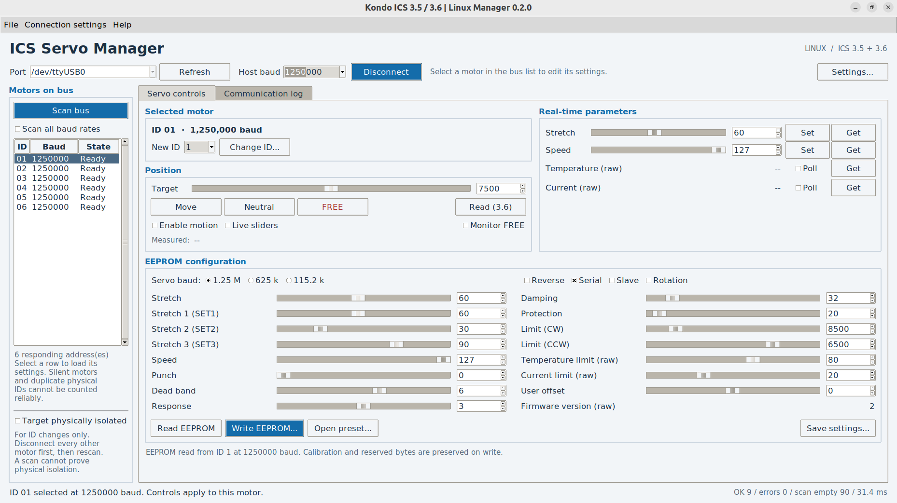

# Kondo ICS Linux Manager 0.2.0

A native Python/Tkinter manager for **Kondo ICS 3.5/3.6 servos connected through a Kondo USB adapter**, using `/dev/ttyUSB*`. Keep the same adapter, cables, servo power and ICS-mode switch position used with the Windows manager.

This is an independent implementation, not a Wine wrapper. Commands, EEPROM mapping and manager timing were inspected in the supplied Windows Manager **1.2.1.0** and cross-checked against Kondo protocol material. The software has been tested on daisy chained KRS2552R2HV motors.



## New in 0.2.0

- **Bus discovery:** scans IDs 0–31 with addressed EEPROM reads, without commanding motion. The list shows each detected ID, baud and response state. Scan the selected baud, or enable **Scan all baud rates**.
- **Per-motor editing:** selecting a row switches the host baud and loads that motor's EEPROM plus current stretch/speed. Motion, telemetry, runtime changes and EEPROM writes use the selected motor's ID. All exposed configuration parameters can be edited with other motors connected.
- **ID collision checks:** a requested ID already detected on the bus is rejected before any write. Previously detected IDs remain reserved for the session even after a motor stops replying, including at another baud rate.
- **ID programming remains isolated-only:** the documented ICS ID-write command is broadcast and has no old-ID/address field. It cannot safely rename one motor on a connected multi-motor bus. Disconnect every other motor, rescan, and tick **Target physically isolated**. The program rechecks all IDs/bauds immediately before the write and blocks if another motor responds.
- **Baud changes:** only the selected motor is written. A verified change updates its list entry; selecting another motor switches the host back to that motor's baud. Conflicting detected `(baud, ID)` destinations are blocked.
- **Three-motor demo:** IDs 0, 4 and 12 at 115200, with different speed settings. No hardware is accessed.

See [CHANGELOG.md](CHANGELOG.md) for upgrade details.

## Install on Ubuntu 22.04 / 24.04

From the extracted `kondo_ics_linux` folder:

```bash
sudo apt install python3-tk python3-venv
python3 -m venv .venv
.venv/bin/python -m pip install -e .
./run.sh
```

If you already use `uv`, replace the two virtual-environment commands with:

```bash
uv venv --python /usr/bin/python3 .venv
uv pip install --python .venv/bin/python -e .
```

Using the system Python here ensures that Ubuntu's `python3-tk` is available.
Python 3.10 or later is required; the only extra Python runtime dependency is pySerial.
No C++ compilation, GPIO libraries, .NET runtime or Windows DLLs are required.

Run without hardware:

```bash
./run.sh --demo
```
Run with hardware:

```bash
./run.sh
```

The title explicitly identifies the virtual bus. Demo data is synthetic, not a model-specific factory preset.

## Serial permissions

If the adapter already appears as `/dev/ttyUSB0`, select that device. If opening it gives a permission error:

```bash
sudo usermod -aG dialout "$USER"
```

Log out and back in, then launch the GUI as your normal user. Do not run the GUI with `sudo`.

If the Kondo adapter does not appear as a serial device, consult [Kondo's Linux adapter instructions](https://kondo-robot.com/faq/usb_adapter_for_linux_2024).
For a **Dual USB Adapter HS with USB ID `165c:0008`**, their temporary driver-binding procedure is:

```bash
lsusb
sudo modprobe ftdi_sio
printf '165c 0008\n' | sudo tee /sys/bus/usb-serial/drivers/ftdi_sio/new_id
```

Use `0006` only if `lsusb` identifies your **ICS USB Adapter HS** as `165c:0006`. Do not copy a product ID that does not match your adapter. This binding may need repeating after reboot. The program does not modify drivers or udev rules.

## First use

1. Connect the motor bus using the same Kondo USB adapter, cables and power supply as the Windows setup. Motors must have distinct IDs at a given baud; a scan cannot reliably count multiple motors that already share the same ID.
2. Choose `/dev/ttyUSB0` (or the actual device) and the bus's known baud. **Auto** scans 115200, 625000 and 1250000. All discovery probes are addressed reads; broadcast Get ID is not used.
3. Click **Connect**. The list shows responding addresses. Select a row to load that motor's settings. Use **Scan bus** after changing connections. Enable **Scan all baud rates** to find motors at different rates. Connection and scanning do not command motion. Silent/slave-mode motors, unpowered motors and motors at unsupported rates cannot be discovered.
4. Check the displayed settings. **Save settings** exports `.sdt` or JSON. Before changing any EEPROM settings, retain a backup.
5. To move the servo, tick **Enable motion**, choose a position and press **Move** or **Neutral**. **Live sliders** sends slider changes after a 100 ms debounce. **FREE** releases torque and reads position. **Monitor FREE** repeats this operation; **Read (3.6)** reads position without changing torque state.
6. Edit configuration values and click **Write EEPROM**. Review the values in the dialog. The program reads the actual servo again, saves a pre-write backup, updates only user parameters, writes once, switches host baud if needed, and verifies the result by readback.

Backups: `~/.local/share/kondo-ics-manager/backups/`.
An unavailable/mismatching acknowledgement is logged. It never triggers an automatic repeat write. If readback fails, the write is explicitly **unverified**; it may already have succeeded.

After an unverified write, further writes to that selection are blocked until a successful read. Scan all baud rates or power-cycle and rescan as appropriate. Some firmware requires a power cycle for baud changes to take effect. The bus GUI does not send the original Windows manager's undocumented broadcast recovery probe.

Switching motors or starting a scan stops polling, cancels queued live-slider changes, clears measurements and disarms motion. Unsaved form edits are replaced by the selected motor's fresh hardware values; save a settings file first if you want to keep them. Target selection is locked during serial operations.

**Changing ID:** enter an unused value in **New ID**, then **Change ID**. A duplicate request shows an error without sending an ID-write. To program an unused ID, physically isolate the selected motor, rescan, and confirm isolation. A single response does not prove only one motor is connected: silent devices and duplicate physical IDs can evade discovery. Reconnect the other motors after programming, then rescan. The list retains no-reply entries and reserves their IDs until a different port is selected or the program restarts; successful renaming frees the old ID.

## Controls

| Windows functionality | Linux implementation |
|---|---|
| COM selection / connect | Editable `/dev/ttyUSB*` selection, refresh, connect/disconnect |
| Baud / Auto | Addressed scans across all three ICS baud rates; host follows selected motor |
| Bus discovery | Scrollable list of IDs, baud rates and reply states; scan one/all rates |
| ID Get / Set | Scan replaces broadcast Get ID; duplicate check, isolated-only write and readback |
| Position / neutral / FREE | Slider, integer entry, Move, Neutral, FREE, continuous FREE monitoring |
| Real-time stretch / speed | Slider/entry, Set, Get; optional live sending |
| Temperature / current | Raw readings and independent polling |
| EEPROM Read / Write | Full read, preserved calibration, backups and full readback verification |
| EEPROM parameters | Stretch; SET1/2/3; speed; punch; dead band; response; damping; protection; clockwise/counter-clockwise limits; temperature/current limits; user offset |
| EEPROM modes | Reverse, Serial, Slave, Rotation; servo baud |
| Firmware version | Read-only raw firmware byte |
| File Open / Save | Original Kondo `.sdt` import/export plus JSON |
| Factory values | Open the matching `.sdt` from your original ZIP, then Write |
| Status | Status bar, transaction counters and timestamped exportable TX/RX logs |
| Extra ICS 3.6 function | Position read without releasing torque |

The UI is English. The original Japanese language switching and hidden factory-calibration/force-write controls are not reproduced. All servo controls in the supplied screenshot are implemented. Manufacturer calibration, internal offset, firmware version, ID and reserved bytes cannot be edited through the normal EEPROM form; they are preserved from the fresh hardware read. ID is changed only through **Set ID**.

## Connection settings

The defaults target the Kondo adapter:

- **8 data bits, even parity, 1 stop bit (8E1)**; no flow control.
- **TX echo enabled**. The Kondo adapter returns the outgoing bytes before the servo reply. The program validates and removes those bytes explicitly.
- **15 ms pre-transmission delay**, recovered from the Windows manager.
- **50 ms response budget** plus calculated wire time. The Windows program uses a 50 ms *per-byte* timeout; Linux uses one bounded deadline for the complete transaction.
- **1000 ms EEPROM response budget**.
- **No broadcast EEPROM recovery in the bus GUI**: after the write, wait 500 ms, select the requested baud and read back the addressed motor. The Windows manager's 57600-baud broadcast probe is omitted because its behavior on a bus is undocumented. A low-level legacy option remains available only with an explicit `isolated=True` argument; it is off by default and is never enabled by this GUI.
- Telemetry polling runs at a minimum 200 ms interval and never overlaps another transaction.

The Kondo adapter handles half-duplex direction. There is no Raspberry Pi GPIO enable pin or copied `synchronize()` timing routine.

The old non-HS ICS USB adapter supports only 115200; use a compatible HS adapter for the higher baud rates. Actual nonstandard baud support is also dependent on the Linux USB serial driver.

## Important interpretation details

- Temperature and current are **raw protocol values**, exactly as in the original GUI. A raw temperature limit of 80 is not 80 °C.
- Position replies report the angle sampled when the command was received, not proof that the target has been reached.
- Stretch in EEPROM is stored as twice the displayed value. User offset uses the original manager's reversed signed-byte convention.
- Factory `.sdt` presets contain `255` placeholders. These are accepted for files but never transmitted. Only valid displayed fields are merged onto a fresh hardware image.
- **Slave** suppresses replies; subsequent readback may be unavailable. The program must then report an unverified write. It never calls an echo alone a successful servo response.
- Leaving Serial unchecked permits the servo's power-on serial/PWM selection, as in the original manager.
- Real-time parameter controls use the original parameter commands. For persistence, explicitly write EEPROM; check behavior after a power cycle on your servo. The older English protocol reference and newer manager manual use inconsistent wording about persistence.
- The protocol has no checksum for these commands. Header, echo, field and length checks improve detection but cannot detect every possible bit error or duplicate-ID collision.
- Closing/disconnecting does not send a new motion or FREE command. Use FREE explicitly if needed.

## Diagnostics and testing

The **Communication log** tab records exact hexadecimal TX/RX, rejected stale bytes, errors and transaction times. Use **Save log** for debugging. Empty scan addresses are logged as `EMPTY` and counted separately as **scan empty**; they are expected. Partial/malformed responses, missing adapter echo and unavailable baud rates are reported as scan issues. The number of responding addresses is not proof of the physical motor count.

Run the tests:

```bash
.venv/bin/python -m unittest discover -s tests -v
```

See `docs/PROTOCOL_FINDINGS.md` for the recovered commands, EEPROM layout and observed Windows timing, and `docs/VALIDATION.md` for test coverage and remaining hardware checks.

## Project layout

- `ics_manager/transport.py`: Kondo USB serial transport and echo/timeout handling.
- `ics_manager/controller.py`: packet commands and EEPROM transaction workflow.
- `ics_manager/eeprom.py`: EEPROM mapping and `.sdt`/JSON files.
- `ics_manager/gui.py`: native Tkinter/ttk GUI, one serial worker, main-thread UI updates.
- `ics_manager/demo.py`: virtual single motor and multi-motor bus for demos and integration testing.
- `tests/`: fixed protocol fixtures and transport/workflow/GUI tests.

No manufacturer executable, DLL, icons, or decompiled implementation is distributed in this project. This is not an official Kondo product.
